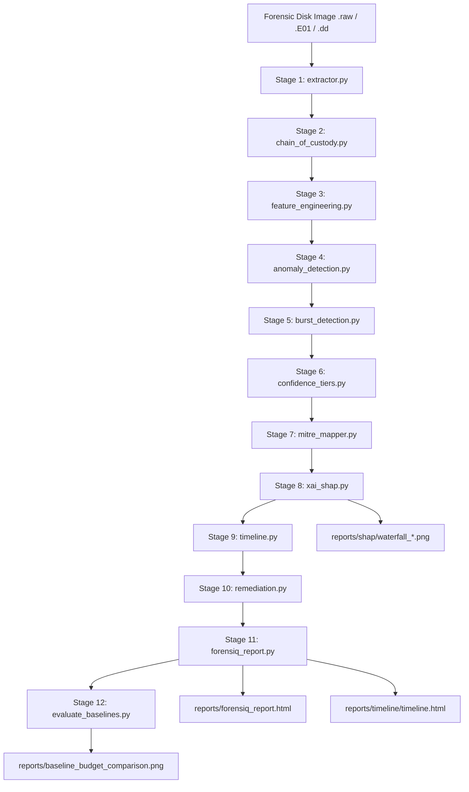

# ForensIQ: AI-Powered Autonomous Digital Forensics & Incident Response

[](https://python.org)
[](https://scikit-learn.org/)
[-green)](https://github.com/shap/shap)
[](https://attack.mitre.org/)
[-purple)](https://www.sleuthkit.org/)
[](#8-cryptographic-manifest--evidentiary-integrity)

**ForensIQ** is an autonomous, publication-grade **Digital Forensics & Incident Response (DFIR)** platform. It combines non-invasive raw disk filesystem parsing (`$MFT`, Windows Event Logs, Prefetch, Registry) with **unsupervised machine learning (Isolation Forest & k-NN Outlier Detection)** and **Explainable AI (TreeSHAP)** to triage massive forensic disk images in minutes, surface high-priority anomalies, explain why they are suspicious, map them to **MITRE ATT&CK®**, and evaluate performance against rigorous forensic baselines.

---

## Table of Contents
- [1. Overview & Core Capabilities](#1-overview--core-capabilities)
- [2. The 12-Stage Automated Pipeline](#2-the-12-stage-automated-pipeline)
- [3. The 17-Feature Forensic Feature Space](#3-the-17-feature-forensic-feature-space)
- [4. Scientific Baseline Benchmark (Milestone 5)](#4-scientific-baseline-benchmark-milestone-5)
- [5. Installation & Environment Setup](#5-installation--environment-setup)
- [6. Quick Start & Execution](#6-quick-start--execution)
- [7. Explainable AI & Attributions (SHAP)](#7-explainable-ai--attributions-shap)
- [8. MITRE ATT&CK® Mapping & Evidence Cards](#8-mitre-attck-mapping--evidence-cards)
- [9. Cryptographic Manifest & Evidentiary Integrity](#9-cryptographic-manifest--evidentiary-integrity)
- [10. Technical Handbooks & Documentation](#10-technical-handbooks--documentation)
- [11. Output Directory Structure](#11-output-directory-structure)

---

## 1. Overview & Core Capabilities

Traditional digital forensic triage is overwhelmed by scale: modern enterprise endpoints contain over **1,000,000 files** and millions of event log lines. Human examiners cannot inspect every artifact, while static signatures (hashes, YARA rules) fail against living-off-the-land techniques (LOLBins) and novel insider threats.

**ForensIQ bridges this gap with:**
* **Non-Invasive Image Extraction:** Parses raw disk images (`.raw`, `.dd`, `.001`) and Expert Witness Compression Format (`.E01`) without mounting partitions, preventing evidentiary contamination.
* **17-Feature Forensic Space:** Standardized features combining MACB timestamps (with zero-timestamp masking), file size, deleted bitmask flags, binary/archive indicators, user/temp paths, and prefetch execution records.
* **Unsupervised Anomaly Detection:** Utilizes Isolation Forest and k-Nearest Neighbor density estimation to surface subtle anomalies without requiring labeled training datasets.
* **Explainable AI (TreeSHAP):** Transparently deconstructs why each file was flagged into game-theoretic Shapley attributions ($\phi_i$), generating per-file waterfall charts and global beeswarm summary plots.
* **Evidence-Linked ATT&CK Mapping:** Translates anomalies into MITRE Enterprise techniques (e.g., `T1070.006 Timestomping`, `T1052.001 Removable Media`, `T1036.005 Masquerading`) backed by verifiable observation cards.
* **Scientific Equal-Budget Benchmarks:** Evaluates retrieval performance at matched examiner review budgets ($K \in \{25, 50, 100, 250, 500, 1000, 4250\}$) against random sampling, domain rules, and univariate baselines.
* **Cryptographic Verification Manifest:** Computes streaming dual hashes (MD5, SHA-256) across all 102 extracted artifacts to maintain runtime evidentiary auditability.

---

## 2. The 12-Stage Automated Pipeline



### Pipeline Execution Stages

| Stage | Script Name | Stage Title | Forensic Function & Technical Output |
|:---:|:---|:---|:---|
| **1** | `extractor.py` | Data Extraction | Extracts raw MFT metadata, EVT/EVTX logs, registry hives, and prefetch from disk images. |
| **2** | `chain_of_custody.py` | Cryptographic Manifest | Computes streaming SHA-256 and MD5 hashes of all 102 extracted artifacts into `chain_of_custody.json`. |
| **3** | `feature_engineering.py` | Feature Engineering | Generates the standardized 17-feature matrix (`X_matrix.npy`, `scaler.pkl`) with zero-timestamp masking. |
| **4** | `anomaly_detection.py` | ML Anomaly Detection | Trains Isolation Forest, flags the top 5% anomalous records, and serializes `iforest_bundle.pkl`. |
| **5** | `burst_detection.py` | Temporal Burst Detection | Performs moving-window temporal aggregation on MFT modifications to detect rapid staging or wiping. |
| **6** | `confidence_tiers.py` | Confidence Calibration | Ranks flagged candidates into CRITICAL, HIGH, MEDIUM, and LOW risk tiers based on score quartiles. |
| **7** | `mitre_mapper.py` | MITRE ATT&CK Mapping | Maps anomaly signatures to MITRE Enterprise tactics and generates ATT&CK Navigator JSON layers. |
| **8** | `xai_shap.py` | Explainable AI (SHAP) | Computes TreeExplainer attributions (`data=X_flagged_raw`), waterfall charts, and beeswarm summary plots. |
| **9** | `timeline.py` | Timeline Generation | Fuses MFT filesystem activity and EVTX security logs into an interactive UTC timeline (`timeline.html`). |
| **10** | `remediation.py` | Remediation Scripts | Generates containment PowerShell scripts tailored to detected breach indicators (account, malware, USB). |
| **11** | `forensiq_report.py` | Master Report Assembly | Validates CoC hashes, evaluates genuine ground truth, and compiles executive HTML dashboard. |
| **12** | `evaluate_baselines.py`| Baseline Benchmark | Compares retrieval against Random, Heuristic Rules, Univariate, and k-NN at matched review budgets ($K$). |

---

## 3. The 17-Feature Forensic Feature Space

Every feature in ForensIQ possesses a defined forensic rationale, unit, and calculation formula:

| # | Feature Name | Unit | Source Artifact | Formula & Calculation | Forensic Rationale |
|---|---|---|---|---|---|
| **1** | `delta_mc` | Seconds | NTFS `$MFT` | `\|m_time - c_time\|` if $(m > 0 \land c > 0)$ else $0.0$ | Detects timestomping metadata manipulation. |
| **2** | `delta_mb` | Seconds | NTFS `$MFT` | `\|m_time - cr_time\|` if $(m > 0 \land cr > 0)$ else $0.0$ | Detects file backdating prior to creation on volume. |
| **3** | `delta_ab` | Seconds | NTFS `$MFT` | `\|a_time - cr_time\|` if $(a > 0 \land cr > 0)$ else $0.0$ | Identifies anomalous access relative to birth time. |
| **4** | `future_m` | Binary | NTFS `$MFT` | $1 \text{ if } m\_time > \text{now\_ts} \text{ else } 0$ | Flags timestamps set into the future (tampering). |
| **5** | `zero_size_recent`| Binary | NTFS `$MFT` | $1 \text{ if } (\text{size} = 0) \land (\text{recent}) \text{ else } 0$ | Detects zero-byte staging files and wiper touch artifacts. |
| **6** | `size` | Bytes | NTFS `$MFT` | $\text{meta.size}$ | Detects massive exfiltration dumps or undersized code. |
| **7** | `is_deleted` | Binary | NTFS `$MFT` | $bool(\text{flags} \ \& \ \text{TSK\_FS\_META\_FLAG\_UNALLOC})$ | Identifies shift-deleted records residing in free space. |
| **8** | `is_exe` | Binary | File Path | Ends with `.exe`, `.dll`, `.sys`, `.scr` | Isolates executable machine code and drivers. |
| **9** | `is_archive` | Binary | File Path | Ends with `.zip`, `.rar`, `.7z`, `.tar`, `.gz` | Flags data compression archives used for staging. |
| **10**| `temp_path` | Binary | File Path | Contains `/temp/` or `/tmp/` | Detects malware drops and staging in temporary paths. |
| **11**| `user_path` | Binary | File Path | Contains `/users/` or `/documents and settings/` | Differentiates user actions from OS background processes. |
| **12**| `credential_tool`| Binary| Prefetch | `mimikatz`, `pwdump`, `cain`, `123wasp`, `stored` | Cross-artifact indicator of credential-dumping execution. |
| **13**| `sniffer_tool` | Binary | Prefetch | `wireshark`, `ethereal`, `tcpdump`, `winpcap` | Flags network packet sniffing and reconnaissance tools. |
| **14**| `powershell_exec`| Binary| Prefetch | `powershell.exe` in prefetch | Flags script interpreter execution for living-off-the-land. |
| **15**| `cmd_exec` | Binary | Prefetch | `cmd.exe` in prefetch | Flags command prompt execution for batch staging/wiping. |
| **16**| `script_host` | Binary | Prefetch | `wscript.exe` or `cscript.exe` in prefetch | Flags Windows Scripting Host execution. |
| **17**| `usb_present` | Binary | Registry | `SYSTEM\CurrentControlSet\Enum\USBSTOR` | Corroborates physical external storage drive attachment. |

---

## 4. Scientific Baseline Benchmark (Milestone 5)

Evaluated on the **85,017 file records** of the NIST CFReDS Data Leakage PC image against all **19 ground-truth target artifacts** present on disk:

| Ranking Method | K=25 | K=50 | K=100 | K=250 | K=500 | K=1000 | K=4250 (5% Triage) |
|:---|:---:|:---:|:---:|:---:|:---:|:---:|:---:|
| **Random Baseline** (10 Seeds) | $0.0 \pm 0.0$ | $0.0 \pm 0.0$ | $0.0 \pm 0.0$ | $0.0 \pm 0.0$ | $0.0 \pm 0.0$ | $0.1 \pm 0.3$ | $1.3 \pm 1.2$ |
| **Rule: .exe under /Program Files** | $0/19$ | $0/19$ | $0/19$ | $0/19$ | $0/19$ | $1/19$ | $1/19$ |
| **Rule: Suspicious Paths (User/Temp)** | $0/19$ | $0/19$ | $1/19$ | **$12/19$** | **$12/19$** | **$12/19$** | **$13/19$** |
| **Univariate: delta_mc** | $0/19$ | $0/19$ | $0/19$ | $0/19$ | $0/19$ | $0/19$ | $0/19$ |
| **Univariate: delta_ab** | $0/19$ | $0/19$ | $0/19$ | $0/19$ | $0/19$ | $0/19$ | $0/19$ |
| **Univariate: File Size** | $0/19$ | $0/19$ | $0/19$ | $0/19$ | $0/19$ | $1/19$ | $6/19$ |
| **Isolation Forest (17 Feats, Seed 42)** | $0/19$ | $0/19$ | $0/19$ | $0/19$ | $0/19$ | $0/19$ | **$7/19$** |
| **Isolation Forest Multi-Seed (0–9)** | $0.0 \pm 0.0$ | $0.0 \pm 0.0$ | $0.0 \pm 0.0$ | $0.0 \pm 0.0$ | $0.0 \pm 0.0$ | $0.0 \pm 0.0$ | **$6.6 \pm 1.6$** |
| **k-NN Distance Outlier ($k=5$)** | $0/19$ | $0/19$ | $0/19$ | $0/19$ | $3/19$ | $4/19$ | **$12/19$** |
| **Ablation: MACB Deltas Only** | $0/19$ | $0/19$ | $0/19$ | $0/19$ | $0/19$ | $0/19$ | $0/19$ |
| **Ablation: Path Heuristics Only** | $0/19$ | $0/19$ | $0/19$ | $0/19$ | $0/19$ | $0/19$ | $2/19$ |

### Scientific Insights
1. **Domain Rules Win at Low Budgets ($K \le 250$)**: Simple path heuristics (`\Users\` and `\Temp\`) encode examiner experience directly, flagging 12 of 19 insider artifacts by $K=250$. Unsupervised Isolation Forest ranks giant OS registry hives and database schemas in its top-250 due to extreme raw size and birth deltas.
2. **ML Wins on Complex Multi-Modal Threats ($K = 4,250$)**: Narrow rules (`.exe` under `/Program Files`) completely miss 16 of the 19 targets because modern insider threats involve non-executable files (databases, LNK shortcuts, and exfiltrated docs). At the 5% triage budget ($K=4,250$), **Isolation Forest recovers 7 targets** and **k-NN recovers 12 targets**.

---

## 5. Installation & Environment Setup

### System Requirements
* **Operating System**: Windows 10/11, Ubuntu 22.04 LTS, or macOS 13+.
* **Python Runtime**: Python 3.12 (recommended).
* **RAM / Disk**: Minimum 8 GB RAM; 20 GB free disk space for raw image extraction.

### Installation
```bash
# Clone the repository
git clone https://github.com/juveenasnowlyn-jpg/ForensIQ.git
cd ForensIQ

# Install core dependencies
pip install -r requirements.txt
```

---

## 6. Quick Start & Execution

### 1. Run the Complete 12-Stage Pipeline
```bash
py -3.12 run_pipeline.py
```

### 2. Skip Extraction (Use Stored Artifacts)
```bash
py -3.12 run_pipeline.py --skip-extraction
```

### 3. Start at a Specific Pipeline Stage
```bash
py -3.12 run_pipeline.py --start-at 3
```

### 4. Run the Milestone 5 Scientific Benchmark
```bash
py -3.12 evaluate_baselines.py
```

### 5. Inspect Registered Pipeline Steps
```bash
py -3.12 run_pipeline.py --list-steps
```

---

## 7. Explainable AI & Attributions (SHAP)

ForensIQ resolves the black-box limitation of machine learning using **TreeSHAP**:
* **Input-Consistency**: Attributions are computed on the exact fitted model and raw feature matrix (`data=X_flagged_raw`).
* **Waterfall Attribution**: Generates individual waterfall PNG charts for the top 10 most anomalous files in `reports/shap/`.
* **Global Beeswarm Summary**: Outputs `reports/shap/shap_summary_beeswarm.png` illustrating global feature importance across all flagged files.

---

## 8. MITRE ATT&CK® Mapping & Evidence Cards

In compliance with forensic science standards, ForensIQ replaces aggressive leaps with **ATT&CK Evidence Cards**:

| Technique | Observed Signal | Alternative Explanations | Required Corroboration | Assessment Status |
|:---|:---|:---|:---|:---|
| **T1070.006 Timestomping** | Divergence between `$SI:m_time` and `$SI:c_time` (`delta_mc > 86400s`). | Archive extraction; software installers unpacking older legacy DLLs. | Compare `$STANDARD_INFORMATION` with kernel-protected `$FILE_NAME` ($FN) timestamps and USN Journal. | **HYPOTHESIS / SUSPICIOUS DELTA** |
| **T1070.001 Log Clearing** | Hourly continuity gap in event logs during business hours (`event_count == 0`). | Workstation powered off, suspended, or disconnected from network. | Event ID 1102 (Security cleared) or Event ID 104 (System cleared); power state uptime verification. | **OBSERVED GAP / NEEDS POWER CORROB.** |
| **T1052.001 USB Exfiltration** | Registry key `SYSTEM\CurrentControlSet\Enum\USBSTOR` contains connected drive. | Authorized business thumb drive; connection without data copy. | LNK shortcut files or Shellbags proving navigation of removable drive letter; MFT unallocated file copy traces. | **POSSIBLE CONNECTION / REQUIRES FILE-COPY** |
| **T1486 Ransomware** | Multiple archive files (`.zip`, `.rar`, `.7z`) flagged in user folders. | Normal user compression; backup archives; downloaded installers. | Presence of ransom notes; Shannon entropy $>7.8$ across document extensions; dropped locker binaries. | **UNVERIFIED / DATA COMPRESSION ONLY** |
| **T1003.002 SAM Dumping** | Prefetch execution record matching `pwdump`, `cain`, or `mimikatz`. | Antivirus scanning SAM hive; Volume Shadow Copy (VSS) routine backups. | Prefetch execution count $>0$; Event ID 4688 process execution logs; output hash dump text files. | **HIGH RISK / PENDING RUNTIME PROOF** |
| **T1036.005 Masquerading** | File extension conflicts with binary magic header (e.g. `.jpg` containing Excel XML). | Software bug or inadvertent user file extension naming. | Magic byte file header confirmation; LNK shortcuts showing file opened in conflicting host application. | **CONFIRMED MASQUERADING** |

---

## 9. Cryptographic Manifest & Evidentiary Integrity

ForensIQ implements an automated **Cryptographic Manifest Verification System** in `chain_of_custody.py`:
* Computes dual SHA-256 and MD5 hashes across all 102 extracted evidence items at runtime.
* Outputs `reports/chain_of_custody.json` and verifies integrity during report assembly (`reports/coc_verification.csv`).
* *Forensic Rigor Note*: While this provides runtime integrity verification against accidental contamination, it is accurately documented as a cryptographic verification manifest rather than an ISO/IEC 27037 legal chain of custody.

---

## 10. Technical Handbooks & Documentation

All technical references, mathematical derivations, and researcher action protocols are compiled into standalone PDF handbooks:

| Document | Format | Description |
|:---|:---:|:---|
| [**ForensIQ Complete Technical Handbook**](file:///d:/Projects/ForensIQ-main/ForensIQ-main/ForensIQ_Complete_Technical_Handbook.pdf) | PDF | 12-stage architecture, 17-feature space formulas, Isolation Forest mathematics, TreeSHAP theory, and baseline benchmark findings. |
| [**ForensIQ Researcher Action Guide**](file:///d:/Projects/ForensIQ-main/ForensIQ-main/ForensIQ_Researcher_Action_Guide.pdf) | PDF | Step-by-step action protocols, cross-image partition offsets, manual triage checklists (FTK/Autopsy), and research paper narrative guidelines. |

---

## 11. Output Directory Structure

```
ForensIQ-main/
├── artifacts/                  # Raw extracted forensic artifacts
│   ├── evtx/                   # Parsed Windows Event Logs (parsed_events.json)
│   ├── mft/                    # Parsed NTFS MFT records (mft_records.json)
│   ├── prefetch/               # Extracted Windows Prefetch list (.pf metadata)
│   ├── registry/               # Extracted SYSTEM, SOFTWARE, SAM hives
│   └── usb/                    # Reconstructed USB connection artifacts
├── features/                   # Engineered matrices & serialization bundles
│   ├── file_index.csv          # 1-to-1 path index mapping (85,017 rows)
│   ├── macb_features.csv       # Raw 17-feature table (85,017 rows)
│   ├── log_gap_features.csv    # Hourly event log continuity bins
│   ├── X_raw.npy               # Unscaled numeric matrix (85017, 17)
│   ├── X_matrix.npy            # Standardized feature matrix (85017, 17)
│   ├── scaler.pkl              # Serialized StandardScaler
│   ├── flagged_anomalies.csv   # Top 5% flagged candidates (4,227 files)
│   ├── shap_values.npy         # TreeExplainer attributions (4227, 17)
│   └── shap_explanations.csv   # Explanations with dominant feature drivers
├── models/                     # Trained models & calibration bundles
│   ├── iforest.pkl             # Scikit-learn Isolation Forest estimator
│   ├── iforest_bundle.pkl      # Bundled (model, scaler, feature_cols)
│   └── scaler.pkl              # Preprocessing scaler copy
├── reports/                    # Generated audit reports & visualizations
│   ├── forensiq_report.html    # Master HTML executive dashboard
│   ├── ground_truth_metrics.json # Verifiable target detection metrics
│   ├── chain_of_custody.json   # Dual-hash verification manifest
│   ├── coc_verification.csv    # Runtime hash verification status
│   ├── anomaly_scores.png      # Score distribution plot with quartiles
│   ├── baseline_comparison_results.json # Equal-budget benchmark data
│   ├── baseline_budget_comparison.png   # Investigation budget curves
│   ├── timeline/               # Interactive timeline (timeline.html, timeline.csv)
│   └── shap/                   # SHAP beeswarm plot & top 10 waterfall charts
├── evaluate_baselines.py       # Milestone 5 Scientific Evaluation Engine
├── run_pipeline.py             # 12-Stage Pipeline Orchestrator
├── ForensIQ_Complete_Technical_Handbook.pdf  # Comprehensive Technical Handbook
└── ForensIQ_Researcher_Action_Guide.pdf      # Researcher Action & Audit Guide
```

---

## 12. License & Contributing

ForensIQ is licensed under the Apache 2.0 License. Contributions adhering to DFIR integrity standards and scientific reproducibility protocols are welcomed via pull request.
