# ForensIQ — Complete Feature & Code Documentation

> Every module, class, method, function, component, prop, and data connection — explained with input/output behavior.

---

## Table of Contents

1. [Architecture Overview](#architecture-overview)
2. [Data Flow Diagram](#data-flow-diagram)
3. [Python Backend](#python-backend)
   - [config.py](#configpy)
   - [extractor.py](#extractorpy)
   - [feature_engineering.py](#feature_engineeringpy)
   - [anomaly_detection.py](#anomaly_detectionpy)
   - [run_pipeline.py](#run_pipelinepy)
   - [timeline.py](#timelinepy)
4. [React Frontend (forensiq-ui)](#react-frontend-forensiq-ui)
   - [main.jsx & App.jsx](#mainjsx--appjsx)
   - [Hero.jsx](#herojsx)
   - [Dashboard.jsx](#dashboardjsx)
   - [Navbar.jsx](#navbarjsx)
   - [MetricCard.jsx](#metriccardjsx)
   - [SuspiciousFilesTable.jsx](#suspiciousfilestablejsx)
   - [Timeline.jsx](#timelinejsx)
   - [NetworkGraph.jsx](#networkgraphjsx)
   - [InvestigationTimeline.jsx](#investigationtimelinejsx)
5. [Data Contracts](#data-contracts)
6. [Input/Output Matrix](#inputoutput-matrix)

---

## Architecture Overview

ForensIQ is a **two-part** project:

```mermaid
graph LR
    subgraph "Python Backend Pipeline"
        A[config.py] --> B[extractor.py]
        B --> C[feature_engineering.py]
        C --> D[anomaly_detection.py]
        D --> E[timeline.py]
        F[run_pipeline.py] -->|orchestrates| B
        F -->|orchestrates| C
        F -->|orchestrates| D
        F -->|orchestrates| E
    end

    subgraph "React Frontend - Pitch Deck"
        G[App.jsx] --> H[Hero.jsx]
        G --> I[Dashboard.jsx]
        I --> J[Navbar.jsx]
        I --> K[MetricCard.jsx]
        I --> L[SuspiciousFilesTable.jsx]
        I --> M[Timeline.jsx]
        I --> N[NetworkGraph.jsx]
        O[mockState.json] -->|data| I
    end

    style A fill:#1a1c2e,stroke:#7dd3fc
    style F fill:#1a1c2e,stroke:#fb7185
```



> [!IMPORTANT]
> The Python backend and React frontend are **completely independent**. The frontend uses hardcoded mock data and does not read any Python output. They share a repository but no data.

### Project Purpose

| Layer | Purpose |
|-------|---------|
| **Python Backend** | Analyze a raw Windows disk image (targeting Windows XP), extract forensic artifacts, detect anomalous files using Isolation Forest ML, and generate offline HTML reports |
| **React Frontend** | A cinematic pitch-deck / demo UI showcasing what the ForensIQ product would look like in a SOC environment |

---

## Data Flow Diagram

```mermaid
flowchart TD
    IMG["🔒 Raw Disk Image (.dd)"] --> EXT["extractor.py"]
    
    EXT --> MFT["artifacts/mft/mft_records.json"]
    EXT --> EVT["artifacts/evt/parsed_events.json"]
    EXT --> EVTX["artifacts/evtx/parsed_events.json"]
    EXT --> PF["artifacts/prefetch/prefetch_list.json"]
    EXT --> USB["artifacts/usb/SYSTEM"]
    
    MFT --> FE["feature_engineering.py"]
    EVT --> FE
    EVTX --> FE
    
    FE --> MACB["features/macb_features.csv"]
    FE --> LGF["features/log_gap_features.csv"]
    FE --> XMAT["features/X_matrix.npy"]
    FE --> XRAW["features/X_raw.npy"]
    FE --> FIDX["features/file_index.csv"]
    
    XMAT --> AD["anomaly_detection.py"]
    XRAW --> AD
    FIDX --> AD
    
    AD --> MODEL["models/iforest.pkl"]
    AD --> FLAG["features/flagged_anomalies.csv"]
    AD --> CHART["reports/anomaly_scores.png"]
    
    FLAG --> TL["timeline.py"]
    MFT --> TL
    EVT --> TL
    EVTX --> TL
    CHART --> TL
    
    TL --> CSV["reports/timeline/timeline.csv"]
    TL --> HTML["reports/timeline/timeline.html"]
    TL --> DASH["reports/dashboard.html"]
    
    style IMG fill:#2d1b1b,stroke:#fb7185
    style MODEL fill:#1b2d1b,stroke:#22c55e
    style HTML fill:#1b1b2d,stroke:#7dd3fc
    style DASH fill:#1b1b2d,stroke:#7dd3fc
```



---

## Python Backend

---

### config.py

**File:** [config.py](file:///d:/Projects/ForensIQ-main/ForensIQ-main/config.py)

Central configuration module. All other modules import constants from here.

#### Constants

| Constant | Type | Default | Env Variable | Purpose |
|----------|------|---------|-------------|---------|
| `BASE_DIR` | `str` | Directory of `config.py` | — | Anchor for all relative paths |
| `IMAGE_PATH` | `str` | `images/SCHARDT_COMPLETE.dd` | `FORENSIQ_IMAGE_PATH` | Path to the raw disk image |
| `PART_OFFSET` | `int` | `63` | `FORENSIQ_PART_OFFSET` | Partition offset in sectors |
| `SECTOR_SIZE` | `int` | `512` | `FORENSIQ_SECTOR_SIZE` | Sector size in bytes |
| `OUT_DIR` | `str` | `artifacts/` | `FORENSIQ_OUT_DIR` | Extracted artifacts directory |
| `FEAT_DIR` | `str` | `features/` | `FORENSIQ_FEAT_DIR` | Computed features directory |
| `MODEL_DIR` | `str` | `models/` | `FORENSIQ_MODEL_DIR` | Trained model storage |
| `REPORT_DIR` | `str` | `reports/` | `FORENSIQ_REPORT_DIR` | Generated reports directory |
| `CONTAMINATION` | `float` | `0.05` | `FORENSIQ_CONTAMINATION` | Isolation Forest anomaly ratio (5% = expect 5% of files are anomalous) |

#### How It's Connected

Every other Python module does `from config import ...`. Configuration flows **downward** into all pipeline stages. Environment variables take precedence over defaults.

---

### extractor.py

**File:** [extractor.py](file:///d:/Projects/ForensIQ-main/ForensIQ-main/extractor.py)

The first pipeline stage. Opens a raw disk image and extracts forensic artifacts.

#### Class: `DiskImage`

**Location:** [Line 28](file:///d:/Projects/ForensIQ-main/ForensIQ-main/extractor.py#L28)

```python
class DiskImage:
    def __init__(self, path, offset_sectors)
```

| Parameter | Type | Description |
|-----------|------|-------------|
| `path` | `str` | Absolute path to the raw disk image file |
| `offset_sectors` | `int` | Partition start offset in sectors |

**What it does:**
1. Checks that `pytsk3` is installed (raises `RuntimeError` if not)
2. Opens the raw image using `pytsk3.Img_Info(path)`
3. Opens the filesystem at `offset_sectors * SECTOR_SIZE` bytes
4. Opens the root directory for traversal
5. Prints filesystem type info

**Attributes:**
- `self.img` — pytsk3 image handle
- `self.fs` — pytsk3 filesystem handle
- `self.root` — root directory object

**Input → Output:**
| Input | Output |
|-------|--------|
| Valid disk image path, correct offset | `DiskImage` object with open handles |
| Missing pytsk3 | `RuntimeError` |
| Wrong path | `IOError` from pytsk3 |
| Wrong offset | `IOError` — mounts wrong filesystem or fails |

---

#### Function: `_decode_name(name)`

**Location:** [Line 40](file:///d:/Projects/ForensIQ-main/ForensIQ-main/extractor.py#L40)

Converts a filesystem entry name (bytes or string) to a UTF-8 string.

| Input | Output |
|-------|--------|
| `b"file.txt"` | `"file.txt"` |
| `b"\xff\xfe"` (invalid UTF-8) | `"��"` (replacement characters) |
| `"already_string"` | `"already_string"` |

---

#### Function: `_ensure_dir(path)`

**Location:** [Line 46](file:///d:/Projects/ForensIQ-main/ForensIQ-main/extractor.py#L46)

Creates the directory (and parents) if it doesn't exist. Returns the path.

---

#### Function: `extract_file_from_image(disk, img_path)`

**Location:** [Line 51](file:///d:/Projects/ForensIQ-main/ForensIQ-main/extractor.py#L51)

Reads the raw bytes of a file from within the disk image.

| Parameter | Type | Description |
|-----------|------|-------------|
| `disk` | `DiskImage` | Open disk image |
| `img_path` | `str` | In-image path (e.g., `/WINDOWS/system32/config/AppEvent.Evt`) |

**Returns:** `bytes` — the complete file content

---

#### Function: `extract_mft(disk, out_dir=OUT_DIR)`

**Location:** [Line 58](file:///d:/Projects/ForensIQ-main/ForensIQ-main/extractor.py#L58)

Recursively walks the filesystem tree and dumps metadata for every file and directory.

**How it works:**
1. Defines inner function `walk_dir()` that recursively traverses directories
2. For each entry, skips `.` and `..`
3. Reads metadata: path, inode, size, type (file/dir), MACB timestamps (m_time, a_time, c_time, cr_time), deletion status
4. Appends to records list
5. Recurses into subdirectories
6. Writes all records to `artifacts/mft/mft_records.json`

**Output record format:**
```json
{
  "path": "/WINDOWS/system32/file.dll",
  "inode": 12345,
  "size": 65536,
  "type": "file",
  "m_time": 1092931200,
  "a_time": 1092931200,
  "c_time": 1092931200,
  "cr_time": 1092931200,
  "is_deleted": false
}
```

**Edge cases:**
| Input | Output |
|-------|--------|
| Image with 5000 files | 5000-record JSON array |
| Corrupted filesystem entries | Silently skipped (bare `except Exception`) |
| Empty filesystem | Empty JSON array `[]` |
| No meta on entry | `inode: -1`, `size: 0`, timestamps: `0` |

---

#### Function: `_load_pyevt()`

**Location:** [Line 101](file:///d:/Projects/ForensIQ-main/ForensIQ-main/extractor.py#L101)

Attempts to import the `pyevt` library (libyal's EVT parser).

| Outcome | Returns |
|---------|---------|
| Import succeeds | `(pyevt_module, None)` |
| Import fails | `(None, ImportError_exception)` |

---

#### Function: `_read_attr(obj, *names, default=None)`

**Location:** [Line 109](file:///d:/Projects/ForensIQ-main/ForensIQ-main/extractor.py#L109)

Safely reads an attribute from an object, trying multiple attribute names in order. Handles both property-style and method-style attributes (calls it if callable).

| Input | Behavior |
|-------|----------|
| `_read_attr(record, "event_id", "identifier")` | Tries `record.event_id` first, then `record.identifier` |
| Callable attribute | Calls it: `record.event_id()` |
| No matching attribute | Returns `default` |

This function is essential because different versions of `pyevt` have different API surfaces.

---

#### Function: `_normalize_timestamp(value)`

**Location:** [Line 121](file:///d:/Projects/ForensIQ-main/ForensIQ-main/extractor.py#L121)

Converts various timestamp formats to ISO 8601 UTC string.

| Input Type | Input Example | Output |
|------------|---------------|--------|
| `None` or `""` | — | `""` |
| `datetime` (naive) | `datetime(2004, 8, 19, 13, 0)` | `"2004-08-19T13:00:00+00:00"` (assumes UTC) |
| `datetime` (aware) | `datetime(2004, ..., tzinfo=utc)` | ISO 8601 UTC string |
| Large `int` (FILETIME) | `127389312000000000` | Converts from Windows FILETIME → Unix → ISO |
| Medium `int` (millis) | `1092844800000` | Divides by 1000 → Unix → ISO |
| Small `int` (Unix) | `1092844800` | Direct Unix → ISO |
| String | `"some text"` | `"some text"` (passthrough) |

---

#### Function: `_event_id_from_record(record)`

**Location:** [Line 143](file:///d:/Projects/ForensIQ-main/ForensIQ-main/extractor.py#L143)

Extracts the event ID from a pyevt record, applying `& 0xFFFF` mask to get the 16-bit event ID (Windows event IDs are 16-bit, but the raw identifier may include qualifiers in upper bits).

| Input | Output |
|-------|--------|
| Record with event_identifier = `0x80001234` | `(0x1234, 0x80001234)` → `(4660, 2147488308)` |
| Record with no event ID | `("", "")` |

---

#### Function: `_strings_from_record(record)`

**Location:** [Line 158](file:///d:/Projects/ForensIQ-main/ForensIQ-main/extractor.py#L158)

Extracts the event message strings from a pyevt record. Tries multiple API approaches:
1. Direct `strings` attribute (iterable)
2. Indexed access via `get_string(idx)` / `get_event_string(idx)`

Returns a list of strings.

---

#### Function: `_iter_pyevt_records(evt_file)`

**Location:** [Line 184](file:///d:/Projects/ForensIQ-main/ForensIQ-main/extractor.py#L184)

Generator that yields records from an open pyevt file. Adapts to different API versions:
1. Tries direct `records` attribute (iterable)
2. Falls back to indexed access via `get_record(idx)`

---

#### Function: `_open_pyevt_file(pyevt, raw_path)`

**Location:** [Line 207](file:///d:/Projects/ForensIQ-main/ForensIQ-main/extractor.py#L207)

Opens a `.Evt` file for reading with pyevt.

---

#### Function: `_parse_evt_file(raw_path, source_log)`

**Location:** [Line 213](file:///d:/Projects/ForensIQ-main/ForensIQ-main/extractor.py#L213)

Parses a single XP-era `.Evt` file into structured event records.

**Flow:**
1. Load pyevt library
2. Open the EVT file
3. Iterate over all records
4. Extract: timestamp, source_log, event_id, event_type, source_name, computer, record_number, message, raw_strings
5. Close the file (in `finally` block)
6. Return list of event dicts

**Output record:**
```json
{
  "timestamp": "2004-08-19T13:22:01+00:00",
  "source_log": "SysEvent.Evt",
  "event_id": 6005,
  "event_type": "4",
  "source_name": "EventLog",
  "computer": "HOSTNAME",
  "record_number": 123,
  "message": "Event log service started",
  "raw_strings": ["Event log service started"],
  "raw_event_identifier": 6005
}
```

---

#### Function: `extract_evt(disk, out_dir=OUT_DIR)`

**Location:** [Line 254](file:///d:/Projects/ForensIQ-main/ForensIQ-main/extractor.py#L254)

Extracts and parses Windows XP legacy `.Evt` log files.

**Targets:** Three hardcoded paths:
- `/WINDOWS/system32/config/AppEvent.Evt` (Application log)
- `/WINDOWS/system32/config/SecEvent.Evt` (Security log)
- `/WINDOWS/system32/config/SysEvent.Evt` (System log)

**For each file:**
1. Extract raw bytes from the disk image
2. Save to `artifacts/evt/{filename}`
3. Parse with `_parse_evt_file()`
4. Accumulate all events

**Writes:**
- `artifacts/evt/parsed_events.json` — all parsed events
- `artifacts/evt/extraction_summary.json` — per-file extraction stats

| Scenario | Output |
|----------|--------|
| All 3 EVT files exist + pyevt installed | Full parsed events JSON |
| EVT files exist, no pyevt | Raw files extracted, `parsed_events.json` = `[]` |
| EVT files missing from image | Summary with error messages, `parsed_events.json` = `[]` |

---

#### Function: `extract_evtx(disk, out_dir=OUT_DIR)`

**Location:** [Line 298](file:///d:/Projects/ForensIQ-main/ForensIQ-main/extractor.py#L298)

Extracts and parses modern Windows `.evtx` log files (Vista+).

**How it works:**
1. Check if `python-evtx` and `lxml` are available
2. Try to open `/Windows/System32/winevt/Logs` directory
3. For each `.evtx` file: extract, save, parse XML structure using `lxml`
4. Extract SystemTime, EventID, Level, Provider, Computer, EventRecordID

> [!NOTE]
> This function is primarily future-proofing. Windows XP images (the stated target) don't have `.evtx` files.

---

#### Function: `extract_prefetch(disk, out_dir=OUT_DIR)`

**Location:** [Line 354](file:///d:/Projects/ForensIQ-main/ForensIQ-main/extractor.py#L354)

Extracts Windows Prefetch files from `/WINDOWS/Prefetch`.

**Output per file:** `{ name, size, m_time, path }`

Writes `artifacts/prefetch/prefetch_list.json`.

> [!NOTE]
> Only extracts raw `.pf` files and records metadata. Does **not** parse prefetch internal structure (execution count, dependencies, etc.).

---

#### Function: `extract_usb_history(disk, out_dir=OUT_DIR)`

**Location:** [Line 392](file:///d:/Projects/ForensIQ-main/ForensIQ-main/extractor.py#L392)

Extracts the SYSTEM registry hive from `/WINDOWS/system32/config/system`.

**Output:** `artifacts/usb/SYSTEM` (raw hive file)

> [!NOTE]
> Does **not** parse the hive. The print message suggests using external tools: `regripper -r artifacts/usb/SYSTEM -p usbstor`

---

#### Function: `main()`

**Location:** [Line 409](file:///d:/Projects/ForensIQ-main/ForensIQ-main/extractor.py#L409)

Orchestrates all extraction steps:
1. Open disk image
2. `extract_mft()`
3. `extract_evt()`
4. `extract_evtx()`
5. `extract_prefetch()`
6. `extract_usb_history()`

Returns `0` on success, `1` on failure.

---

### feature_engineering.py

**File:** [feature_engineering.py](file:///d:/Projects/ForensIQ-main/ForensIQ-main/feature_engineering.py)

Second pipeline stage. Transforms raw extracted data into numerical features for the ML model.

#### Constant: `EVENT_LOG_CANDIDATES`

**Location:** [Line 11](file:///d:/Projects/ForensIQ-main/ForensIQ-main/feature_engineering.py#L11)

```python
EVENT_LOG_CANDIDATES = (
    os.path.join(OUT_DIR, "evt", "parsed_events.json"),
    os.path.join(OUT_DIR, "evtx", "parsed_events.json"),
)
```

Tries EVT (XP) first, then EVTX (modern). Uses the first one that exists.

---

#### Function: `_first_existing_path(paths)`

**Location:** [Line 17](file:///d:/Projects/ForensIQ-main/ForensIQ-main/feature_engineering.py#L17)

Returns the first path in the list that exists on disk, or `None`.

---

#### Function: `build_macb_features()`

**Location:** [Line 24](file:///d:/Projects/ForensIQ-main/ForensIQ-main/feature_engineering.py#L24)

Builds MACB (Modified, Accessed, Changed, Born) timestamp features from MFT records.

**Steps:**
1. Load `artifacts/mft/mft_records.json`
2. Filter to only `"type": "file"` entries
3. Compute features:

| Feature | Formula | What It Detects |
|---------|---------|-----------------|
| `delta_mc` | `abs(m_time - c_time)` | Large gap between modification and change time → suspicious backdating |
| `delta_mb` | `abs(m_time - cr_time)` | Large gap between modification and creation → timestomping |
| `delta_ab` | `abs(a_time - cr_time)` | Large gap between access and creation → unusual access patterns |
| `future_m` | `m_time > now` (boolean) | File claims modification in the future → clock manipulation |
| `zero_size_recent` | `size == 0 AND modified < 24h ago` (boolean) | Zero-byte files recently created → potential indicator of data destruction |
| `size` | Raw file size | Unusually large or small files |

4. Save to `features/macb_features.csv`

**Input → Output:**
| Input | Output |
|-------|--------|
| 5000 MFT records, 3000 files | CSV with 3000 rows × 7 columns (path + 6 features) |
| All directories, no files | Empty CSV (will cause downstream crash) |
| Missing `mft_records.json` | `FileNotFoundError` crash |

---

#### Function: `build_log_gap_features()`

**Location:** [Line 49](file:///d:/Projects/ForensIQ-main/ForensIQ-main/feature_engineering.py#L49)

Analyzes Windows event log timing patterns to detect suspicious gaps.

**Steps:**
1. Find the first existing parsed event log file
2. Parse timestamps, convert to UTC datetime
3. Floor timestamps to hour boundaries
4. Count events per hour across the full time range
5. Compute:

| Feature | Description |
|---------|-------------|
| `hour` | The hour bucket (datetime) |
| `event_count` | Number of events in that hour |
| `gap` | Boolean: 0 events during work hours (8am–6pm) → potential log clearing |
| `log_z_score` | Z-score of event count relative to the mean → outlier detection |
| `is_workhour` | Boolean: hour falls in 8am–6pm range |

**Output:** `features/log_gap_features.csv`

> [!IMPORTANT]
> **This output is never consumed** by any downstream module. It's an orphaned computation.

**Edge cases:**
| Input | Output |
|-------|--------|
| No parsed event logs exist | Empty CSV with column headers only |
| Events exist but all timestamps are unparseable | Empty CSV with column headers |
| 1000 events over 48 hours | 48-row CSV with gap/z-score analysis |

---

#### Function: `build_feature_matrix()`

**Location:** [Line 97](file:///d:/Projects/ForensIQ-main/ForensIQ-main/feature_engineering.py#L97)

Converts the MACB feature CSV into a standardized numerical matrix for ML.

**Steps:**
1. Load `features/macb_features.csv`
2. Extract the 6 numeric feature columns into a raw numpy array
3. Apply `StandardScaler` (zero mean, unit variance normalization)
4. Save:
   - `features/X_matrix.npy` — standardized feature matrix
   - `features/X_raw.npy` — original unscaled values
   - `features/file_index.csv` — file paths (row index)

**StandardScaler behavior:** For each column, computes `(x - mean) / std`. This ensures all features are on the same scale for Isolation Forest.

| Input (3000 files) | Output |
|---------------------|--------|
| `macb_features.csv` (3000 × 7) | `X_matrix.npy` shape (3000, 6), `X_raw.npy` shape (3000, 6), `file_index.csv` 3000 rows |

---

### anomaly_detection.py

**File:** [anomaly_detection.py](file:///d:/Projects/ForensIQ-main/ForensIQ-main/anomaly_detection.py)

Third pipeline stage. Trains an Isolation Forest model and identifies suspicious files.

#### Constant: `FEATURE_COLUMNS`

```python
FEATURE_COLUMNS = ["delta_mc", "delta_mb", "delta_ab", "future_m", "zero_size_recent", "size"]
```

Used to label columns when creating the results DataFrame.

---

#### Function: `train_and_report()`

**Location:** [Line 16](file:///d:/Projects/ForensIQ-main/ForensIQ-main/anomaly_detection.py#L16)

The main function. Trains an Isolation Forest and generates reports.

**Isolation Forest Parameters:**
| Parameter | Value | Meaning |
|-----------|-------|---------|
| `n_estimators` | 200 | Number of isolation trees |
| `contamination` | 0.05 | Expected proportion of anomalies (5%) |
| `max_samples` | "auto" | Uses min(256, n_samples) per tree |
| `random_state` | 42 | Deterministic results |

**How Isolation Forest works:**
- Builds random trees that isolate data points by randomly selecting features and split values
- Anomalies are isolated in fewer splits (shorter path length)
- `decision_function(X)` returns scores: **lower = more anomalous**
- `predict(X)` returns: `+1` (normal) or `-1` (anomaly)

**Steps:**
1. Load `X_matrix.npy` (standardized features) and `file_index.csv` (paths)
2. Train the IsolationForest model
3. Score all files: `decision_function(X)` → anomaly scores
4. Predict labels: `predict(X)` → +1 (normal) or -1 (anomaly)
5. Save model to `models/iforest.pkl`
6. Build results DataFrame: path + raw features + anomaly_score + is_anomaly
7. Filter flagged anomalies, sort by score (most suspicious first)
8. Save to `features/flagged_anomalies.csv`
9. Print top 10 suspicious files
10. Generate score distribution histogram plot

**Plot details:**
- X-axis: anomaly score (lower = more suspicious)
- Y-axis: file count
- Red dashed line: threshold at the `CONTAMINATION`-th percentile
- Dark theme with cyan bars on a dark blue background
- Saved as `reports/anomaly_scores.png` at 150 DPI

**Input → Output:**
| Input | Output |
|-------|--------|
| 3000-file feature matrix, contamination=0.05 | ~150 flagged anomalies, model pickle, score plot |
| Empty matrix | `ValueError` crash (no guard) |
| 10-file matrix | Works but model quality is poor with so few samples |

**Returns:** `(results_df, flagged_df)` — though no caller uses the return value when run as `__main__`.

---

### run_pipeline.py

**File:** [run_pipeline.py](file:///d:/Projects/ForensIQ-main/ForensIQ-main/run_pipeline.py)

Orchestrator script. Runs all pipeline stages in order as subprocesses.

#### Constant: `STEPS`

```python
STEPS = [
    ("extract", ROOT / "extractor.py"),
    ("features", ROOT / "feature_engineering.py"),
    ("anomaly", ROOT / "anomaly_detection.py"),
    ("reports", ROOT / "timeline.py"),
]
```

Defines the pipeline order.

---

#### Constant: `REQUIRED` / `OPTIONAL`

```python
REQUIRED = {
    "extractor": ["pytsk3"],
    "features": ["pandas", "numpy", "sklearn"],
    "anomaly": ["pandas", "numpy", "sklearn", "matplotlib", "seaborn"],
    "reports": ["pandas"],
}
OPTIONAL = {
    "xp_evt_parser": "pyevt",
    "modern_evtx_parser": "Evtx",
}
```

Maps each step to its required Python modules.

---

#### Function: `has_module(name)`

**Location:** [Line 28](file:///d:/Projects/ForensIQ-main/ForensIQ-main/run_pipeline.py#L28)

Uses `importlib.util.find_spec()` to check if a Python module is installed without importing it.

---

#### Function: `dependency_report()`

**Location:** [Line 32](file:///d:/Projects/ForensIQ-main/ForensIQ-main/run_pipeline.py#L32)

Returns `(missing_required, optional_status)`:
- `missing`: sorted set of required modules that aren't installed
- `optional`: dict of `{label: bool}` showing which optional modules are available

---

#### Function: `print_header()`

**Location:** [Line 38](file:///d:/Projects/ForensIQ-main/ForensIQ-main/run_pipeline.py#L38)

Prints pipeline configuration: Python path, image path, output directories.

---

#### Function: `fail_for_missing_dependencies(missing, optional)`

**Location:** [Line 50](file:///d:/Projects/ForensIQ-main/ForensIQ-main/run_pipeline.py#L50)

Prints error messages for missing dependencies and returns `True` if the pipeline should abort.

| Input | Output |
|-------|--------|
| No missing modules | Prints info about optional pyevt, returns `False` |
| Missing `pytsk3` | Prints install instructions, returns `True` |
| Python ≥ 3.13 | Adds warning about compatibility |

---

#### Function: `run_step(name, script)`

**Location:** [Line 71](file:///d:/Projects/ForensIQ-main/ForensIQ-main/run_pipeline.py#L71)

Runs a pipeline step as a subprocess using the current Python interpreter.

```python
result = subprocess.run([sys.executable, str(script)], cwd=str(ROOT))
```

Returns `True` on success (exit code 0), `False` on failure.

---

#### Function: `main()`

**Location:** [Line 80](file:///d:/Projects/ForensIQ-main/ForensIQ-main/run_pipeline.py#L80)

1. Print header
2. Check disk image exists
3. Check dependencies
4. Run each step in order (stops on first failure)
5. Print final status with paths to dashboard and timeline

---

### timeline.py

**File:** [timeline.py](file:///d:/Projects/ForensIQ-main/ForensIQ-main/timeline.py)

Fourth and final pipeline stage. Generates the unified timeline and HTML reports.

#### Constants

| Constant | Value |
|----------|-------|
| `TIMELINE_COLUMNS` | `["timestamp", "source", "event_id", "description", "score", "kind", "severity"]` |
| `EVENT_LOG_CANDIDATES` | Paths to both EVT and EVTX parsed JSON files |

---

#### Function: `ts_to_dt(unix_ts)`

**Location:** [Line 26](file:///d:/Projects/ForensIQ-main/ForensIQ-main/timeline.py#L26)

Converts a Unix timestamp integer to a UTC `datetime`.

| Input | Output |
|-------|--------|
| `1092931200` | `datetime(2004, 8, 19, 12, 0, tzinfo=utc)` |
| `0` | `None` (falsy check) |
| `None` | `None` |
| Invalid int | `None` |

---

#### Function: `parse_dt(value)`

**Location:** [Line 35](file:///d:/Projects/ForensIQ-main/ForensIQ-main/timeline.py#L35)

Parses various datetime formats into a timezone-aware `datetime`.

| Input | Output |
|-------|--------|
| `None` | `None` |
| `datetime` (naive) | Same datetime with UTC assumed |
| `"2004-08-19T13:22:01+00:00"` | Parsed ISO datetime |
| `"2004-08-19T13:22:01Z"` | Converts `Z` → `+00:00`, then parses |

---

#### Function: `read_json(path, default)`

**Location:** [Line 46](file:///d:/Projects/ForensIQ-main/ForensIQ-main/timeline.py#L46)

Safely reads a JSON file. Returns `default` if the file doesn't exist.

---

#### Function: `safe_text(value, fallback="")`

**Location:** [Line 53](file:///d:/Projects/ForensIQ-main/ForensIQ-main/timeline.py#L53)

Converts a value to string, returning `fallback` if `None` or empty.

---

#### Function: `severity_from_event(event)`

**Location:** [Line 60](file:///d:/Projects/ForensIQ-main/ForensIQ-main/timeline.py#L60)

Maps Windows event type codes to severity levels:

| Event Type | Severity |
|------------|----------|
| `"1"`, `"error"`, `"eventlog_error_type"` | `"high"` |
| `"2"`, `"warning"`, `"eventlog_warning_type"` | `"medium"` |
| `"4"`, `"information"`, `"info"`, `"eventlog_information_type"` | `"low"` |
| Anything else | `"neutral"` |

---

#### Function: `collect_anomaly_events()`

**Location:** [Line 71](file:///d:/Projects/ForensIQ-main/ForensIQ-main/timeline.py#L71)

Converts flagged anomalies into timeline events.

**Steps:**
1. Load `features/flagged_anomalies.csv` and `artifacts/mft/mft_records.json`
2. For each flagged file, look up its MFT record to get `m_time`
3. Convert to datetime
4. Create timeline event with:
   - `kind: "anomaly"`
   - `severity: "critical"`
   - `source: "MFT"`
   - `event_id: "ANOMALY"`
   - `description: "Suspicious file: {path}"`
   - `score: anomaly_score`

---

#### Function: `collect_log_events()`

**Location:** [Line 98](file:///d:/Projects/ForensIQ-main/ForensIQ-main/timeline.py#L98)

Converts parsed Windows event logs into timeline events.

For each event from `parsed_events.json`:
- Parse timestamp
- Build description: `"{source_name} EventID {event_id} on {computer}: {message}"`
- Assign severity via `severity_from_event()`
- Set `kind: "eventlog"`, `score: 0.0`

---

#### Function: `build_timeline()`

**Location:** [Line 127](file:///d:/Projects/ForensIQ-main/ForensIQ-main/timeline.py#L127)

Combines anomaly events and log events into a single sorted timeline DataFrame.

| Scenario | Output |
|----------|--------|
| 150 anomalies + 500 log events | 650-row DataFrame sorted by timestamp |
| No anomalies, no logs | Empty DataFrame with TIMELINE_COLUMNS |
| Anomalies only | DataFrame with only anomaly rows |

---

#### Function: `fmt_dt(value)` / `fmt_score(value)` / `h(value)`

**Location:** [Lines 137–152](file:///d:/Projects/ForensIQ-main/ForensIQ-main/timeline.py#L137)

Formatting utilities:
- `fmt_dt`: Datetime → `"YYYY-MM-DD HH:MM:SS UTC"` string
- `fmt_score`: Float → `"0.1234"` string (4 decimal places)
- `h`: HTML-escapes text (XSS prevention)

---

#### Function: `render_event_cards(timeline)`

**Location:** [Line 155](file:///d:/Projects/ForensIQ-main/ForensIQ-main/timeline.py#L155)

Generates HTML card elements for each timeline event. Each card has:
- Color-coded left rail (cyan=neutral, red=critical, orange=high, amber=medium, green=low)
- Timestamp display
- Kind and severity tags
- Source and event ID
- Description
- Anomaly score
- `data-kind`, `data-severity`, `data-text` attributes for JavaScript filtering

---

#### Function: `timeline_summary(timeline)`

**Location:** [Line 181](file:///d:/Projects/ForensIQ-main/ForensIQ-main/timeline.py#L181)

Returns `(total, anomalies, logs, first_time, last_time)` — summary stats for display.

---

#### Function: `base_styles()`

**Location:** [Line 193](file:///d:/Projects/ForensIQ-main/ForensIQ-main/timeline.py#L193)

Returns a large CSS string with the complete dark-themed styling for the HTML reports. Includes:
- CSS custom properties (design tokens)
- Grid-line background pattern
- Animated scan-line effect
- Glassmorphic panels
- Responsive breakpoints (900px)
- Color coding for severity levels

---

#### Function: `signal_stage()`

**Location:** [Line 373](file:///d:/Projects/ForensIQ-main/ForensIQ-main/timeline.py#L373)

Generates a decorative "oscilloscope" SVG visualization with animated bars and a pulsing horizontal line. Purely aesthetic.

---

#### Function: `export_html_timeline(timeline)`

**Location:** [Line 377](file:///d:/Projects/ForensIQ-main/ForensIQ-main/timeline.py#L377)

Generates the full cinematic timeline HTML page.

**Page structure:**
1. Hero section with title "Event Horizon" and signal stage visualization
2. Metric grid: Total events, Anomalies, XP log events, Observed range
3. Sticky toolbar with search input and filter buttons (All / Anomalies / Event logs / Dashboard link)
4. Timeline section with all event cards
5. JavaScript for client-side search and filtering

**JavaScript behavior:**
- Search box filters cards by `data-text` attribute (case-insensitive substring match)
- Filter buttons toggle between showing all events, only anomalies, or only event logs
- Filters combine: both search term AND kind filter must match

---

#### Function: `render_table(headers, rows)`

**Location:** [Line 454](file:///d:/Projects/ForensIQ-main/ForensIQ-main/timeline.py#L454)

Generates an HTML table from headers and row data. Used by the dashboard.

---

#### Function: `export_dashboard(timeline)`

**Location:** [Line 462](file:///d:/Projects/ForensIQ-main/ForensIQ-main/timeline.py#L462)

Generates the main dashboard HTML page.

**Dashboard sections:**
1. Hero: "Case Surface" title with signal stage
2. Metric grid: MFT records, Anomalies, XP event logs, Timeline events
3. Two-column panel grid:
   - Top suspicious files table (top 8 by lowest anomaly score)
   - Event logs by source table
4. Two-column panel grid:
   - Anomaly score distribution image (if `anomaly_scores.png` exists)
   - Report links (timeline, CSV, manual)

---

## React Frontend (forensiq-ui)

Built with **Vite + React 19 + Framer Motion + Tailwind CSS 4**.

---

### main.jsx & App.jsx

**Files:** [main.jsx](file:///d:/Projects/ForensIQ-main/ForensIQ-main/forensiq-ui/src/main.jsx), [App.jsx](file:///d:/Projects/ForensIQ-main/ForensIQ-main/forensiq-ui/src/App.jsx)

**main.jsx:** Standard React entry point. Renders `<App>` inside `<StrictMode>` into the `#root` DOM element.

**App.jsx:** Root component. Renders two sections in order:
1. `<Hero />` — cinematic landing section
2. `<Dashboard />` — SOC dashboard with all data panels

```jsx
export default function App() {
  return (
    <div className="min-h-screen bg-[#020203]">
      <Hero />
      <Dashboard />
    </div>
  );
}
```

**Data flow:** `App` passes no props. `Dashboard` imports `mockState.json` directly.

---

### Hero.jsx

**File:** [Hero.jsx](file:///d:/Projects/ForensIQ-main/ForensIQ-main/forensiq-ui/src/components/Hero.jsx)

Full-viewport cinematic opener with scroll-driven animations.

#### Animation System

| Motion Value | Input Range | Output | Effect |
|-------------|------------|--------|--------|
| `textOpacity` | scroll 0→35% | 1→0 | Text fades out |
| `textY` | scroll 0→35% | 0→-60px | Text moves up |
| `textScale` | scroll 0→35% | 1→0.95 | Text shrinks slightly |
| `glowOpacity` | scroll 0→30% | 1→0 | Glow orb fades |
| `lineHeight` | scroll 35→95% | 0%→100% | Draw-line grows downward |
| `lineOpacity` | scroll 30→45% | 0→1 | Draw-line appears |
| `scrollHintOpacity` | scroll 0→10% | 1→0 | "Scroll" indicator fades quickly |

#### Visual Elements

1. **Tech grid background** — CSS grid pattern with scan-line animation (from `index.css`)
2. **Glow orb** — Radial gradient circle, centered, breathing animation
3. **Headline** — Word-by-word stagger animation: each word fades in with 120ms delay, blur-to-sharp transition
4. **Subline** — "Until now." appears after 1.6s delay
5. **Scroll indicator** — Animated vertical line with "Scroll" label
6. **Draw-line** — Vertical cyan line that grows as user scrolls, connecting Hero to Dashboard

#### Section Height

`150vh` — provides extra scroll runway for the draw-line animation. The inner content is `sticky top-0 h-screen`.

---

### Dashboard.jsx

**File:** [Dashboard.jsx](file:///d:/Projects/ForensIQ-main/ForensIQ-main/forensiq-ui/src/components/Dashboard.jsx)

Main data display section. Orchestrates all sub-components.

#### Props

| Prop | Type | Default | Description |
|------|------|---------|-------------|
| `data` | `object` | `mockState` (imported JSON) | The full case data object |

#### Sub-components Used

| Component | Data Passed | Where |
|-----------|-------------|-------|
| `<Navbar />` | None (static) | Fixed top bar |
| `<MetricCard />` × 5 | `label, value, unit, accent, icon, index` | Metric grid |
| `<NetworkGraph />` | `nodeCount=42, anomalyCount=4` | Anomaly map |
| `<SuspiciousFilesTable />` | `anomalies` array from data | Left panel |
| `<Timeline />` | `events` array from data | Right panel |

#### Metric Cards Configuration

```js
[
  { label: 'Total Extracted',   value: 18.4,  unit: 'GB',    accent: 'cyan' },
  { label: 'Anomalies Flagged', value: 12,    unit: null,    accent: 'red'  },
  { label: 'Logs Parsed',       value: '450k',unit: null,    accent: 'white'},
  { label: 'Scan Duration',     value: 34,    unit: 'sec',   accent: 'cyan' },
  { label: 'Risk Score',        value: 87,    unit: '/ 100', accent: 'red'  },
]
```

Risk Score accent is dynamic: `red` if ≥ 70, `cyan` otherwise.

#### SVG Icons

Five inline SVG icons defined as constants: `IconDatabase`, `IconAlert`, `IconActivity`, `IconClock`, `IconGauge`. Each is a 24×24 viewBox outline icon.

---

### Navbar.jsx

**File:** [Navbar.jsx](file:///d:/Projects/ForensIQ-main/ForensIQ-main/forensiq-ui/src/components/dashboard/Navbar.jsx)

Fixed top navigation bar with glassmorphic effect.

**Elements:**
- **Left:** ForensIQ glyph (layered diamond SVG) + wordmark ("Forens" in cyan, "IQ" in white)
- **Right:** Live Analysis indicator (pulsing green dot) + "Beta" badge
- **Animation:** Slides down from off-screen with 0.2s delay

**Styling:** Semi-transparent background with backdrop-blur, 1px cyan border-bottom.

---

### MetricCard.jsx

**File:** [MetricCard.jsx](file:///d:/Projects/ForensIQ-main/ForensIQ-main/forensiq-ui/src/components/dashboard/MetricCard.jsx)

Glassmorphic stat card with scroll-reveal animation.

#### Props

| Prop | Type | Default | Description |
|------|------|---------|-------------|
| `label` | `string` | — | Uppercase metric label |
| `value` | `string\|number` | — | Display value |
| `unit` | `string\|null` | — | Optional unit suffix |
| `accent` | `'cyan'\|'red'\|'white'` | `'cyan'` | Color theme |
| `icon` | `ReactNode` | — | Optional SVG icon |
| `index` | `number` | `0` | Stagger delay index |

#### Visual Behavior

| Event | Animation |
|-------|-----------|
| Card enters viewport | Slides up from 40px below, fades in (staggered by `0.15s × index`) |
| Value enters viewport | Scales from 0.8 to 1.0 (additional 0.3s delay) |
| Bottom accent line | Grows from 0% to 100% width |
| Hover | Background accent pulse appears, border color changes, icon brightens |

#### Accent Color Map

| Accent | Text Color | Glow Shadow | Hover Border |
|--------|-----------|-------------|--------------|
| `cyan` | `#00f2ff` | `rgba(0,242,255,0.08)` | `#00f2ff/40` |
| `red` | `#ffb4ab` | `rgba(255,180,171,0.08)` | `#ffb4ab/40` |
| `white` | `#dce4e4` | none | `#dce4e4/20` |

---

### SuspiciousFilesTable.jsx

**File:** [SuspiciousFilesTable.jsx](file:///d:/Projects/ForensIQ-main/ForensIQ-main/forensiq-ui/src/components/dashboard/SuspiciousFilesTable.jsx)

Table listing flagged anomalous files with severity-based visual treatment.

#### Props

| Prop | Type | Default | Description |
|------|------|---------|-------------|
| `anomalies` | `array` | `[]` | Array of anomaly objects |

#### Expected Anomaly Object Shape

```json
{
  "id": "ANM-001",
  "path": "C:\\Windows\\System32\\svchost_suspicious.exe",
  "score": -0.85,
  "size_kb": 1024,
  "severity": "critical",
  "category": "Masquerading",
  "description": "Binary mimicking svchost.exe..."
}
```

#### Severity Styles

| Severity | Row Style | Badge | Score Color | Dot |
|----------|-----------|-------|-------------|-----|
| `critical` | Red left border, red background glow, inset shadow | Red badge with glow | Red | Red (with ping animation) |
| `warn` | Yellow left border | Yellow badge | Yellow | Yellow (static) |
| `review` | Muted gray left border | Gray badge | Gray | Gray (static) |

#### Columns

| Column | Width | Content |
|--------|-------|---------|
| Status dot | auto | Severity-colored dot (critical dots ping) |
| File Path | 1fr | Truncated path + category subtitle |
| Size | 100px | Formatted (KB/MB) |
| Score | 80px | Anomaly score to 2 decimal places |
| Severity | 90px | Uppercase badge |

---

### Timeline.jsx

**File:** [Timeline.jsx](file:///d:/Projects/ForensIQ-main/ForensIQ-main/forensiq-ui/src/components/dashboard/Timeline.jsx)

Enhanced investigation timeline with hover-to-reveal forensic metadata.

#### Props

| Prop | Type | Default | Description |
|------|------|---------|-------------|
| `events` | `array` | `[]` | Timeline event objects from mockState |

#### Expected Event Object Shape

```json
{
  "id": "EVT-001",
  "timestamp": "2026-05-24T01:07:58Z",
  "display_time": "01:07:58 UTC",
  "type": "critical",
  "title": "Lateral movement initiated",
  "description": "PsExec remote execution artifact...",
  "metadata": {
    "hex_offset": "0x00FA3C10",
    "mft_record": "$MFT #48291",
    "source_hash": "a3f2c8d1...",
    "inode": "INO-88412",
    "raw_sector": "LBA 0x1E8A0F",
    "evidence_tag": "EV-TAG-0041"
  }
}
```

#### Type Configuration

| Type | Dot Color | Dot Glow | Pulse Ring | Title Color | Badge |
|------|-----------|----------|------------|-------------|-------|
| `critical` | `#ffb4ab` | Red 10px+20px | Yes (pulsing) | `#ffb4ab` | `CRITICAL` on red bg |
| `warn` | `#fed83a` | Gold 8px+16px | No | `#fed83a` | `WARNING` on gold bg |
| `info` | `#00f2ff` | Cyan 8px+16px | No | `#00f2ff` | `INFO` on cyan bg |

#### Sub-component: `TimelineRow`

Each event is rendered by the inner `TimelineRow` component.

**Hover behavior:**
1. Row padding animates larger (8px → 16px)
2. Border appears with event-type color
3. Background subtly tints
4. **Metadata sub-layer reveals** (AnimatePresence) showing:
   - HEX OFFSET
   - MFT RECORD
   - RAW SECTOR
   - INODE
   - SHA-256
   - EVIDENCE TAG

#### Animated Vertical Line

A gradient line (`from cyan to transparent`) animates from 0% to 100% height when the component enters the viewport. This creates the effect of the timeline "filling in" as the user scrolls.

---

### NetworkGraph.jsx

**File:** [NetworkGraph.jsx](file:///d:/Projects/ForensIQ-main/ForensIQ-main/forensiq-ui/src/components/dashboard/NetworkGraph.jsx)

Procedural SVG constellation visualization of the Isolation Forest anomaly detection results.

#### Props

| Prop | Type | Default | Description |
|------|------|---------|-------------|
| `nodeCount` | `number` | `42` | Total nodes in the graph |
| `anomalyCount` | `number` | `4` | Number of anomaly nodes (max 4) |

#### How Node Generation Works

**Function: `generateGraph(nodeCount, anomalyCount, seed)`**

Uses a seeded pseudo-random number generator for deterministic layout:

1. **Anomaly nodes** (up to 4): Placed at fixed anchor positions with slight jitter
   - Positions: `(25,32)`, `(72,24)`, `(58,68)`, `(18,72)` in percentage coordinates
   - Alternating types: `anomalyCyan`, `anomalyGold`, `anomalyCyan`, `anomalyGold`

2. **Normal nodes**: Randomly distributed across the canvas (6% padding from edges)
   - 15% chance of being `normalLarge` (r=3.5, brighter blue)
   - 85% chance of `normal` (r=2.5, dim blue)

3. **Edges**: Connected between nodes within distance threshold (18 units)
   - Max 4 edges per node
   - Anomaly edges are brighter (opacity 0.25 vs 0.06)
   - Anomaly edges use the anomaly node's color (cyan or gold)

#### Node Types

| Type | Color | Radius | Glow | Label |
|------|-------|--------|------|-------|
| `normal` | `#2563eb` (35% opacity) | 2.5 | No | No |
| `normalLarge` | `#3b82f6` (50% opacity) | 3.5 | No | No |
| `anomalyCyan` | `#00f2ff` (100% opacity) | 5 | Yes (cyan filter) | `ANM-001` |
| `anomalyGold` | `#fed83a` (100% opacity) | 5 | Yes (gold filter) | `ANM-002` |

#### Animations

| Element | Animation | Duration |
|---------|-----------|----------|
| Normal nodes | Pulse: scale 1→1.3→1, opacity 0.35→0.55 | 3.5–7s (varied) |
| Anomaly nodes | Pulse: scale 1→1.6→1, opacity 0.8→1 | 2.5–3.7s (varied) |
| Anomaly outer ring | Scale 1→1.8→1, opacity 0.6→0 | Pulse × 1.2 |
| Edges | PathLength 0→1 (draw-in effect) | 1.2s (staggered by 8ms) |
| Node entrance | Scale 0→1 with overshoot spring | 0.5s (staggered by 20ms) |

#### SVG Filters (Glow Effects)

- `glow-cyan`: Gaussian blur + color matrix boosting green/blue channels
- `glow-gold`: Gaussian blur + color matrix boosting red/yellow channels

---

### InvestigationTimeline.jsx

**File:** [InvestigationTimeline.jsx](file:///d:/Projects/ForensIQ-main/ForensIQ-main/forensiq-ui/src/components/dashboard/InvestigationTimeline.jsx)

> [!WARNING]
> **This component is DEAD CODE.** It is not imported or used anywhere. `Timeline.jsx` supersedes it.

A simpler version of the Timeline component without hover-to-reveal metadata. Same basic structure: vertical line, colored dots, staggered entrance, but no metadata sub-layer.

---

## Data Contracts

### mockState.json

**File:** [mockState.json](file:///d:/Projects/ForensIQ-main/ForensIQ-main/forensiq-ui/src/data/mockState.json)

The single data source for the React frontend.

#### Top-Level Structure

```json
{
  "case_id": "FRQ-2026-0417",
  "analyst": "SOC-TEAM-ALPHA",
  "scan_timestamp": "2026-05-24T08:01:33Z",
  "metrics": { ... },
  "anomalies": [ ... ],
  "timeline": [ ... ]
}
```

#### `metrics` Object

| Field | Type | Mock Value | Used By |
|-------|------|------------|---------|
| `total_extracted_gb` | `number` | `18.4` | MetricCard |
| `anomalies_flagged` | `number` | `12` | MetricCard |
| `logs_parsed` | `string` | `"450k"` | MetricCard |
| `scan_duration_sec` | `number` | `34` | MetricCard |
| `risk_score` | `number` | `87` | MetricCard (accent logic) |

#### `anomalies` Array (5 items)

Each object: `{ id, path, score, size_kb, severity, category, mac_modified, mac_accessed, mac_created, description }`

Severities used: `"critical"`, `"warn"`, `"review"`

#### `timeline` Array (5 items)

Each object: `{ id, timestamp, display_time, type, title, description, metadata: { hex_offset, mft_record, source_hash, inode, raw_sector, evidence_tag } }`

Types used: `"critical"`, `"warn"`, `"info"`

---

## Input/Output Matrix

### Python Pipeline Files

| Module | Reads | Writes |
|--------|-------|--------|
| **config.py** | Environment variables | — (constants only) |
| **extractor.py** | Raw disk image (.dd) | `artifacts/mft/mft_records.json`, `artifacts/evt/*.Evt`, `artifacts/evt/parsed_events.json`, `artifacts/evt/extraction_summary.json`, `artifacts/evtx/*.evtx`, `artifacts/evtx/parsed_events.json`, `artifacts/prefetch/*.pf`, `artifacts/prefetch/prefetch_list.json`, `artifacts/usb/SYSTEM` |
| **feature_engineering.py** | `artifacts/mft/mft_records.json`, `artifacts/evt/parsed_events.json` or `artifacts/evtx/parsed_events.json` | `features/macb_features.csv`, `features/log_gap_features.csv`, `features/X_matrix.npy`, `features/X_raw.npy`, `features/file_index.csv` |
| **anomaly_detection.py** | `features/X_matrix.npy`, `features/X_raw.npy`, `features/file_index.csv` | `models/iforest.pkl`, `features/flagged_anomalies.csv`, `reports/anomaly_scores.png` |
| **timeline.py** | `features/flagged_anomalies.csv`, `artifacts/mft/mft_records.json`, `artifacts/evt/parsed_events.json`, `artifacts/evtx/parsed_events.json`, `reports/anomaly_scores.png` | `reports/timeline/timeline.csv`, `reports/timeline/timeline.html`, `reports/dashboard.html` |

### React Component Hierarchy

```
App.jsx
├── Hero.jsx (no props, self-contained)
└── Dashboard.jsx (data = mockState.json)
    ├── Navbar.jsx (no props)
    ├── MetricCard.jsx × 5 (label, value, unit, accent, icon, index)
    ├── NetworkGraph.jsx (nodeCount, anomalyCount)
    ├── SuspiciousFilesTable.jsx (anomalies[])
    └── Timeline.jsx (events[])
        └── TimelineRow (event, index, isInView) [internal]
```

---

> [!NOTE]
> `InvestigationTimeline.jsx` exists in the codebase but is **not part of the component tree** — it's dead code superseded by `Timeline.jsx`.
