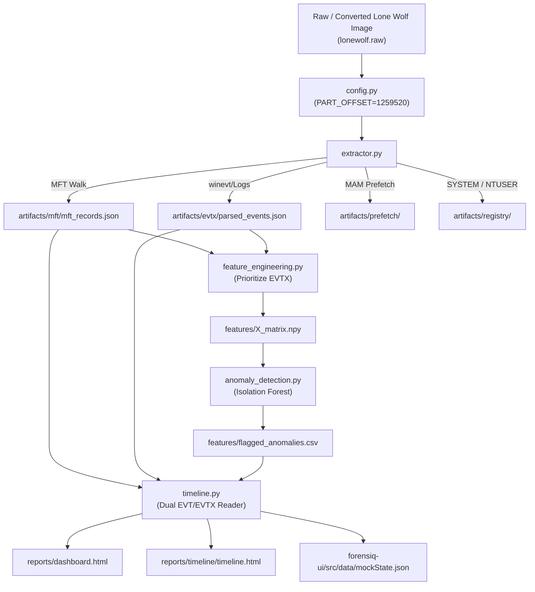

# ForensIQ — Migration & Tweaks Report: 2018 Lone Wolf Dataset (Windows 10 / EVTX)

> [!IMPORTANT]
> **Read-Only Advisory Report:** As instructed, **no code has been modified**. This document provides an exhaustive, step-by-step technical blueprint and gap analysis for transitioning ForensIQ from legacy Windows XP images to modern Windows 10 disk images, specifically targeting the **2018 Lone Wolf (Jim Cloudy)** digital forensics scenario from Digital Corpora.

---

## Executive Summary

The **2018 Lone Wolf Scenario** (George Mason University / Digital Corpora) represents a modern, physical **Windows 10 x64** laptop image. Migrating ForensIQ from its current Windows XP baseline (`SCHARDT_COMPLETE.dd`) to the 2018 Lone Wolf dataset involves **5 architectural layers**:

1. **Image Ingestion & Partitioning:** Transitioning from MBR DOS cylinder offset (`63`) to **GPT (GUID Partition Table)** basic data partition offset (`1259520`), and handling multi-segment `E01` (Expert Witness) files.
2. **Event Log Subsystem (`.evt` → `.evtx`):** Moving from `/WINDOWS/system32/config/` binary `.evt` logs parsed by `pyevt` to modern binary XML `.evtx` logs at `/Windows/System32/winevt/Logs/` parsed via `python-evtx`.
3. **Artifact Pipelines:** Adapting Windows 10 compressed Prefetch (MAM / XPRESS compression vs. XP SCCA v17), updated Windows 10 registry hive paths, and user profiles (`/Users/Jim Cloudy/`).
4. **Data Aggregation & Pipeline Routing:** Resolving hardcoded `evt/parsed_events.json` references in `timeline.py` and `feature_engineering.py` so they dynamically consume `evtx/parsed_events.json`.
5. **Dashboard & Web UI Presentation:** Updating metric labels ("XP event logs" → "Windows Event Logs"), risk scores, and case metadata to reflect the Lone Wolf case profile (`FRQ-CASE-LONEWOLF-2018`).

---

## 1. Dataset Profile: 2018 Lone Wolf (`LoneWolf.E01`–`E09`)

| Parameter | Current Baseline (Schardt XP) | 2018 Lone Wolf Dataset |
| :--- | :--- | :--- |
| **Operating System** | Windows XP Professional SP1 (32-bit) | **Windows 10 Home/Pro x64 (Build 1709 / 16299)** |
| **Disk Format** | Single flat raw `.dd` image | **Multi-segment EnCase E01 (`LoneWolf.E01` to `.E09`)** |
| **Partition Table** | MBR (Master Boot Record) | **GPT (GUID Partition Table)** |
| **Partition Offset** | Sector `63` (`32,256` bytes) | **Sector `1259520`** (Basic Data Partition, ~24 GB) |
| **Sector Size** | 512 bytes | 512 bytes |
| **Event Log Format** | Legacy binary `.evt` (3 logs) | **Binary XML `.evtx` (300+ log channels)** |
| **Event Log Path** | `/WINDOWS/system32/config` | **`/Windows/System32/winevt/Logs`** |
| **Prefetch Format** | Uncompressed SCCA v17 | **MAM / XPRESS-compressed SCCA v30** |
| **User Directory** | `/Documents and Settings/Administrator/` | **`/Users/Jim Cloudy/`** |

---

## 2. Required Tweaks: Module-by-Module Breakdown



---

### Step 1: Image Ingestion & Partition Offset ([config.py](file:///d:/Projects/ForensIQ-main/ForensIQ-main/config.py))

#### Problem:
* The Lone Wolf image is delivered as 9 segmented E01 files (`LoneWolf.E01` to `LoneWolf.E09`). `pytsk3.Img_Info` cannot natively open segmented E01 files on Windows without `libewf` bindings.
* The disk uses **GPT**, where sector 63 is inside the GPT partition header. Pointing `pytsk3.FS_Info` to offset 63 will throw `RuntimeError: Cannot determine file system type`.

#### Inspection with Sleuth Kit `mmls`:
Running `mmls -i raw -t gpt lonewolf.raw` shows:
```text
GUID Partition Table (Sector size: 512)
Units are in 512-byte sectors
      Slot    Start        End          Length       Description
000:  Meta    0000000000   0000000000   0000000001   Safety Table
001:  Meta    0000000001   0000000033   0000000033   GPT Header
002:  Meta    0000000034   0000002047   0000002014   Unallocated
003:  000     0000002048   0001023999   0001021952   Recovery (NTFS)
004:  001     0001024000   0001226751   0000202752   EFI System (FAT32)
005:  002     0001226752   0001259519   0000032768   Microsoft Reserved
006:  003     0001259520   0062533631   0061274112   Basic Data Partition (Main Windows NTFS)
```

#### Required Tweaks in `config.py`:
1. Convert/merge the E01 files to raw:
   ```bash
   ewfexport -t lonewolf_raw -f raw LoneWolf.E01
   # Or mount with Arsenal Image Mounter / FTK Imager as a raw physical drive
   ```
2. Update `config.py` default partition offset and image target:
   ```python
   IMAGE_PATH = os.environ.get(
       "FORENSIQ_IMAGE_PATH",
       os.path.join(BASE_DIR, "images", "LoneWolf.raw"),
   )
   # Windows 10 GPT Basic Data Partition starts at sector 1259520:
   PART_OFFSET = int(os.environ.get("FORENSIQ_PART_OFFSET", "1259520"))
   ```
3. *(Optional Enhancement)* Add auto-detection in `extractor.py` using `pytsk3.Volume_Info(disk.img)` to iterate GPT partitions and automatically find the partition with description `"Basic Data Partition"` or file system type `TSK_FS_TYPE_NTFS`.

---

### Step 2: Modern Event Log Extraction ([extractor.py](file:///d:/Projects/ForensIQ-main/ForensIQ-main/extractor.py))

#### Problem:
* In Windows 10, `/WINDOWS/system32/config/` only contains Registry hives, not event logs.
* Event logs are in `/Windows/System32/winevt/Logs/` with `.evtx` extension.
* There are over 350 `.evtx` files. Extracting and XML-parsing every single record from all 350+ files will cause excessive processing time and high memory consumption.

#### Required Tweaks in `extractor.py`:
1. **Case-Insensitive Directory Traversal:**
   Windows 10 paths may appear as `/Windows/System32/winevt/Logs` or `/WINDOWS/system32/winevt/Logs`. Use case-normalized path resolution when calling `disk.fs.open_dir()`.
2. **Selective Channel Ingestion (Triage Priority Filter):**
   Prioritize high-value forensic event log channels rather than blindly parsing all 350+ logs:
   ```python
   PRIORITY_EVTX_CHANNELS = {
       "security.evtx",
       "system.evtx",
       "application.evtx",
       "microsoft-windows-powershell%4operational.evtx",
       "microsoft-windows-taskscheduler%4operational.evtx",
       "microsoft-windows-terminalservices-localsessionmanager%4operational.evtx",
       "microsoft-windows-codeintegrity%4operational.evtx",
       "microsoft-windows-windows defender%4operational.evtx",
   }
   ```
3. **Optimized Record Extraction:**
   In `extract_evtx()`:
   * Parse `TimeCreated`, `EventID`, `Level`, `Provider` name, `Computer`, and extract the `<Data>` elements from `<EventData>` to build the `message` field (Windows 10 EVTX logs store user sids, target filenames, process names, and command lines inside `<EventData><Data Name="...">...`).
4. **Execution Order in `extractor.py`:**
   In Windows 10, run `extract_evtx()` as the primary log extractor and skip `extract_evt()`.

---

### Step 3: Feature Engineering Adaptation ([feature_engineering.py](file:///d:/Projects/ForensIQ-main/ForensIQ-main/feature_engineering.py))

#### Problem:
`feature_engineering.py` contains:
```python
EVENT_LOG_CANDIDATES = (
    os.path.join(OUT_DIR, "evt", "parsed_events.json"),
    os.path.join(OUT_DIR, "evtx", "parsed_events.json"),
)
```
The helper `_first_existing_path()` returns `evt/parsed_events.json` if the directory exists (even if empty `[]`), completely ignoring the populated `evtx/parsed_events.json`.

#### Required Tweaks in `feature_engineering.py`:
1. **Smart Log File Selection:**
   Change candidate selection to inspect file size and event count:
   ```python
   def _get_active_event_log_path():
       # Prioritize EVTX if it exists and has events
       evtx_path = os.path.join(OUT_DIR, "evtx", "parsed_events.json")
       if os.path.exists(evtx_path) and os.path.getsize(evtx_path) > 10:
           return evtx_path
       evt_path = os.path.join(OUT_DIR, "evt", "parsed_events.json")
       if os.path.exists(evt_path) and os.path.getsize(evt_path) > 10:
           return evt_path
       return None
   ```
2. **Windows 10 Timestamps & Gap Analysis:**
   EVTX timestamps are ISO-8601 UTC strings (`2018-04-16T15:24:10.450123Z`). `pd.to_datetime(df["timestamp"], utc=True)` parses these accurately.
   In the 2018 Lone Wolf dataset, the key activity dates are **April 2018** (specifically April 10–16, 2018). The dataset-relative reference points (`latest_creation` and `latest_activity` introduced in H-2) will automatically calibrate to April 2018 rather than wall-clock time.

---

### Step 4: Timeline & Report Unification ([timeline.py](file:///d:/Projects/ForensIQ-main/ForensIQ-main/timeline.py))

#### Problem:
1. In `export_dashboard()` (line 518):
   ```python
   evt_events = read_json(os.path.join(OUT_DIR, "evt", "parsed_events.json"), [])
   ```
2. In `export_ui_state()` (line 606):
   ```python
   evt_events = read_json(os.path.join(OUT_DIR, "evt", "parsed_events.json"), [])
   ```
Both functions hardcode reading from the legacy `evt/` directory. On a Windows 10 image, `evt_events` will be empty (`0`), causing the Dashboard and React UI to report `0` parsed event logs.
3. The dashboard HTML template displays:
   `<span>XP event logs</span>` and `<small>Parsed legacy EVT records</small>`.

#### Required Tweaks in `timeline.py`:
1. **Multi-Source Event Log Aggregator:**
   ```python
   def load_all_parsed_events():
       events = []
       for candidate in [
           os.path.join(OUT_DIR, "evtx", "parsed_events.json"),
           os.path.join(OUT_DIR, "evt", "parsed_events.json"),
       ]:
           events.extend(read_json(candidate, []))
       return events
   ```
   Use `load_all_parsed_events()` in `export_dashboard()` and `export_ui_state()`.
2. **Dynamic UI Labels:**
   Change `"XP event logs"` to `"Windows Event Logs"` and description to `"Parsed EVTX / EVT records"`.
3. **Category Detection for Modern Threats:**
   Update `export_ui_state()` category mapping to detect Windows 10 cloud artifacts (OneDrive, Dropbox, Mega) and communication remnants present in Lone Wolf:
   ```python
   if "onedrive" in lower_path or "dropbox" in lower_path:
       category = "Cloud Storage Sync"
   elif "mega" in lower_path or "tor" in lower_path:
       category = "Exfiltration / Anonymizer"
   ```

---

### Step 5: Windows 10 Prefetch Decompression

#### Forensic Context:
* In Windows 10, prefetch files (`.pf`) are compressed with Microsoft’s proprietary **XPRESS/MAM** format (header `MAM\x04`).
* While `extractor.py` successfully extracts raw `.pf` files, extracting internal run counts and last-execution timestamps requires decompressing the MAM stream.

#### Recommended Tweak:
Add a Python-native XPRESS decompressor (e.g. using `lznt1` / `xpress` ctypes or `pefile`/`pypf` module) or document running Eric Zimmerman’s `PECmd.exe` on `artifacts/prefetch/`.

---

## 3. Configuration & Execution Cheat Sheet

When ready to analyze the 2018 Lone Wolf dataset, apply these parameters:

### Environment Variables:
```powershell
# Set path to the converted or raw Lone Wolf image
$env:FORENSIQ_IMAGE_PATH = "D:\Forensics\Datasets\LoneWolf\lonewolf.raw"

# Point to GPT Basic Data Partition (Sector 1259520)
$env:FORENSIQ_PART_OFFSET = "1259520"

# Optional: set contamination rate for Isolation Forest (default: 0.05)
$env:FORENSIQ_CONTAMINATION = "0.03"
```

### Verification Checklist Before Running:
- [ ] Converted `LoneWolf.E01-E09` to raw flat image `lonewolf.raw` (or mounted via Arsenal / OSFMount).
- [ ] Confirmed partition offset with `mmls` (`1259520`).
- [ ] Verified `python-evtx` and `lxml` installed in virtual environment (`pip list`).
- [ ] Updated `timeline.py` and `feature_engineering.py` event log candidate readers to merge EVTX.
- [ ] Ran pipeline via `.\venv\Scripts\python.exe run_pipeline.py`.
- [ ] Opened `http://localhost:5173/` or `reports/dashboard.html` to review findings.

---

> [!NOTE]
> All existing code in the repository remains untouched and functional for the current Windows XP baseline. This report serves as the complete technical spec for the upcoming Windows 10 / Lone Wolf deployment.
