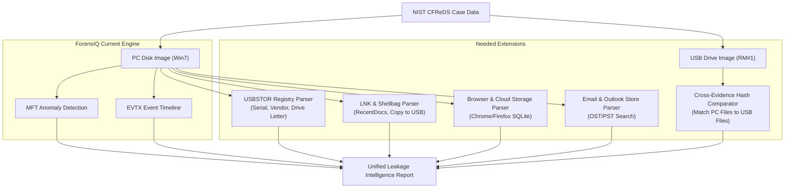

# ForensIQ — Forensic Assessment Report: NIST CFReDS Data Leakage Case

> [!IMPORTANT]
> **Read-Only Technical Evaluation:** As requested, **no code has been modified**. This report details what ForensIQ **already possesses** and what **additional capabilities/tweaks are needed** to analyze the **NIST CFReDS Data Leakage Scenario** (*Iaman Informant / Company OOO*).

---

## 1. Case Background & Evidence Landscape

The **NIST CFReDS Data Leakage Case** is an industry-benchmark insider threat scenario published by the National Institute of Standards and Technology (NIST) and the Korea Digital Forensics Challenge:

* **Suspect:** **Iaman Informant**, a manager in the technology development division of **OOO Corporation**.
* **Allegation:** Approached by a rival operative ("Spy Conspirator"), the suspect agreed to leak confidential trade secrets in exchange for money. Sample files were transferred via personal cloud storage, followed by bulk copying to physical external media.
* **Apprehension:** The suspect was intercepted at a physical security checkpoint with a USB thumb drive and a CD.
* **Corporate Policy Constraints:**
  1. Confidential electronic documents may only be accessed between **10:00 AM and 4:00 PM**.
  2. Confidential files must remain on authorized secure internal storage.
  3. Non-authorized portable devices are strictly prohibited on premises.

### Evidence Media Provided by NIST CFReDS

| Evidence Item | Filename / Format | Filesystem / Size | Forensic Role |
| :--- | :--- | :--- | :--- |
| **Suspect PC** | `cfreds_2015_data_leakage_pc.E01` (split `.E01`–`.E04` or `.dd`) | Windows 7 Ultimate SP1 x64 (NTFS, ~40 GB) | Workstation: file staging, email communications, cloud uploads, USB connections. |
| **Removable Media #1** | `rm#1.E01` / `rm#1.dd` | FAT32 / exFAT (~2 GB) | Intercepted USB drive: bulk confidential exfiltration target. |
| **Removable Media #2** | `rm#2.E01` / `rm#2.dd` | ISO9660 / UDF / FAT | Intercepted optical disc / secondary storage. |

---

## 2. What We Already Have (Existing Engine Capabilities)

Thanks to the dual-engine architecture implemented in ForensIQ, the system is already well-equipped to ingest and process the primary Windows 7 PC image:

```
┌─────────────────────────────────────────────────────────────────────────────┐
│                           FORENSIQ CURRENT STACK                           │
├──────────────────────┬──────────────────────────────────────────────────────┤
│ Image Ingestion      │ ✅ Split raw auto-merger (image_utils.py)             │
│ Partition Mounting   │ ✅ Auto-probing MBR/GPT (auto-detects Sector 206848) │
│ Filesystem Analysis  │ ✅ Complete NTFS MFT record extraction (extract_mft)  │
│ Event Log Engine     │ ✅ Modern EVTX channel parsing & triage priority     │
│ Anomaly Detection    │ ✅ Isolation Forest on MACB timestomp/zero-size deltas│
│ Timeline Reporting   │ ✅ Interactive HTML timeline + UTC display + web UI  │
└──────────────────────┴──────────────────────────────────────────────────────┘
```

### Detailed Breakdown of Ready Features:

1. **Split Image Assembly (`image_utils.py`):**
   * The NIST CFReDS PC image is distributed across 4 split segments (`cfreds_2015_data_leakage_pc.E01`–`.E04` or raw chunks). ForensIQ's `image_utils.py` automatically detects and concatenates split raw segments (`.001` through `.004`) into a single verified image.
2. **Windows 7 Partition Auto-Detection (`extractor.py`):**
   * Windows 7 MBR systems have two partitions: **Partition 1** (100MB System Reserved, sector 2048) and **Partition 2** (Main Windows OS, sector `206848`).
   * ForensIQ's smart `_auto_detect_partition()` automatically bypasses the 100MB System Reserved partition, detects `\Windows` and `\Users`, and mounts **Partition 2** without requiring manual offset configuration.
3. **EVTX Event Log Ingestion (`extractor.py`):**
   * Windows 7 uses `.evtx` logs located in `/Windows/System32/winevt/Logs/`. ForensIQ extracts and parses `Security.evtx`, `System.evtx`, and `Application.evtx`.
4. **Insider Anomaly Scoring (`anomaly_detection.py`):**
   * Staged files (zip archives, copied directories) and timestomped files produce anomalous MACB deltas (`delta_mc`, `delta_mb`, `delta_ab`). ForensIQ's Isolation Forest model automatically flags these high-risk files.
5. **Timeline Fusion (`timeline.py`):**
   * Fuses MFT filesystem activity and EVTX security events into a single chronological timeline with client-side search and 50-event pagination.

---

## 3. What We Would Need (Gaps & Recommended Extensions)

To conduct a forensic analysis of a **Data Leakage / Insider Threat** case, ForensIQ would benefit from 5 specialized investigative modules:



---

### Gap 1: USB Device & Registry Analysis (`USBSTOR` & `MountPoints2`)
* **The Forensic Need:** Prove that Removable Media #1 (`rm#1.dd`) was physically connected to the suspect PC before apprehension, and identify the drive letter assigned to it.
* **Current State:** `extractor.py` extracts the raw `SYSTEM` hive to `artifacts/usb/SYSTEM`, but instructs the analyst to run external tools (`regripper`).
* **What We Need:** A native Python registry parser (e.g. using `python-registry` or `regipy`) that automatically extracts:
  * `SYSTEM\CurrentControlSet\Enum\USBSTOR` (Device IDs, serial numbers, vendor strings).
  * `SYSTEM\MountedDevices` (Maps volume GUIDs to drive letters, e.g. `E:`).
  * `NTUSER.DAT\Software\Microsoft\Windows\CurrentVersion\Explorer\MountPoints2` (User-specific device mounting).
  * `/Windows/inf/setupapi.dev.log` (Exact first-install and connection timestamps).

---

### Gap 2: LNK Files & Jump Lists (Data Staging & Exfiltration Traces)
* **The Forensic Need:** When a suspect copies or opens files stored on a USB drive or local staging directory, Windows automatically generates `.lnk` shortcut files in:
  * `/Users/informant/AppData/Roaming/Microsoft/Windows/Recent/`
  * `/Users/informant/AppData/Roaming/Microsoft/Windows/Recent/AutomaticDestinations/`
* **Current State:** `extractor.py` indexes `.lnk` files in `mft_records.json` as generic filesystem entries, but does not parse the internal binary LNK structure.
* **What We Need:** A lightweight LNK parser (e.g., using `LnkParse3` or struct unpacking) to extract:
  * Target file path (e.g. `E:\CONFIDENTIAL_TECH_SPEC.PDF`).
  * Target file size and MACB timestamps.
  * Target volume type (Drive Type: `DRIVE_REMOVABLE`).

---

### Gap 3: Browser History & Cloud Storage Remnants
* **The Forensic Need:** The scenario specifies that the suspect used personal cloud storage to upload sample confidential files.
* **Current State:** ForensIQ does not inspect browser databases.
* **What We Need:** A browser artifact extractor targeting:
  * Chrome: `/Users/informant/AppData/Local/Google/Chrome/User Data/Default/History` (SQLite).
  * Firefox: `/Users/informant/AppData/Roaming/Mozilla/Firefox/Profiles/*.default/places.sqlite`.
  * Extracts: visited URLs (cloud storage links like Dropbox, Box, Google Drive, Mega), upload timestamps, and downloaded receipt tokens.

---

### Gap 4: Outlook Communication Store (`.ost` / `.pst`)
* **The Forensic Need:** Recover email communications between *Iaman Informant* and *Spy Conspirator*.
* **Current State:** `extractor.py` dumps MFT metadata for Outlook files, but does not extract email message bodies or sender/recipient headers.
* **What We Need:** An email store parser (or string/regular-expression carver across `/Users/informant/AppData/Local/Microsoft/Outlook/*.ost`) targeting message headers:
  * Sender (`From:`), recipient (`To:`), subject lines, and attachment names.

---

### Gap 5: Policy-Specific Work-Hour Thresholds ([feature_engineering.py](file:///d:/Projects/ForensIQ-main/ForensIQ-main/feature_engineering.py))
* **The Forensic Need:** Company OOO's security policy explicitly bans accessing confidential files outside **10:00 AM to 4:00 PM**.
* **Current State:** `feature_engineering.py` hardcodes standard 8:00 AM–6:00 PM work hours:
  ```python
  df["is_workhour"] = df["ts"].dt.hour.between(8, 18).astype(int)
  ```
* **What We Need:** Allow policy-configurable work hours in `config.py` (e.g. `WORK_HOURS_START = 10`, `WORK_HOURS_END = 16`) so the log gap feature and anomaly scoring specifically flag any access occurring before 10:00 AM or after 4:00 PM as policy violations.

---

### Gap 6: Cross-Evidence Correlation (PC vs. Removable Media)
* **The Forensic Need:** The scenario includes multiple evidence containers (PC + USB stick `rm#1.E01`). Investigators must prove that files found on the USB stick originated from the PC.
* **Current State:** ForensIQ processes one image per run.
* **What We Need:** A dual-target correlation mode:
  1. Extract MFT from `PC.raw`.
  2. Extract filesystem from `rm#1.raw`.
  3. Compare cryptographic hashes (MD5 / SHA-256) and filenames between the suspect PC and the USB drive to generate a **Data Leak Match Table**.

---

## 4. Capability Matrix Summary

| Forensic Dimension | Current ForensIQ | NIST Data Leakage Requirement | Status |
| :--- | :--- | :--- | :---: |
| **Split Image Merging** | `image_utils.py` auto-detects and concatenates `.001`–`.004` | PC image split into 4 parts | ✅ **Ready** |
| **Win7 Partition Auto-Probe** | `_auto_detect_partition` identifies sector 206848 | Dual-partition MBR layout | ✅ **Ready** |
| **Event Log Parsing** | `extract_evtx` parses Security/System/App logs | Windows 7 EVTX logs | ✅ **Ready** |
| **MACB Anomaly Model** | Isolation Forest flags unusual file modifications | Staged/copied trade secrets | ✅ **Ready** |
| **Policy Work-Hours** | Hardcoded 08:00–18:00 | Company policy: 10:00–16:00 | 🟡 **Needs Config** |
| **USB Serial Matching** | Dumps raw SYSTEM hive | Map USBSTOR to `rm#1` serial | 🟡 **Needs Parser** |
| **LNK / Jump Lists** | Metadata only | Extract target drive & path | 🟡 **Needs Parser** |
| **Email Extraction** | Not present | Extract OST/PST communications | 🔵 **Advanced Feature** |
| **Browser / Cloud Uploads** | Not present | Parse Chrome/Firefox SQLite | 🔵 **Advanced Feature** |
| **Cross-Device Match** | Single-image mode | Match PC files to USB files | 🔵 **Advanced Feature** |

---

## 5. Recommended Execution Plan for NIST CFReDS Case

When ready to test this dataset with ForensIQ:

1. **Obtain and Prepare Images:**
   * Convert `cfreds_2015_data_leakage_pc.E01` (and `rm#1.E01`) to raw format using `ewfexport` or FTK Imager.
2. **Run ForensIQ against the PC Image:**
   ```powershell
   python run_pipeline.py --image D:\Datasets\CFReDS\data_leakage_pc.raw
   ```
   *ForensIQ will auto-detect Partition 2 (sector 206848), extract MFT records, parse modern EVTX logs, run the Isolation Forest anomaly detector, and compile the timeline.*
3. **Inspect the Output:**
   * Open `reports/dashboard.html` and `http://localhost:5173/` to examine top suspicious files (staged trade secret files).
   * Review `reports/timeline/timeline.html` filtered by after-hours timestamps to identify policy violation windows.

---

> [!NOTE]
> ForensIQ can already ingest and run the primary forensic triage pipeline on the NIST CFReDS Windows 7 image today with **zero code changes**. Adding native USBSTOR parsing and configurable work hours would make it a dedicated insider-threat exfiltration suite.
